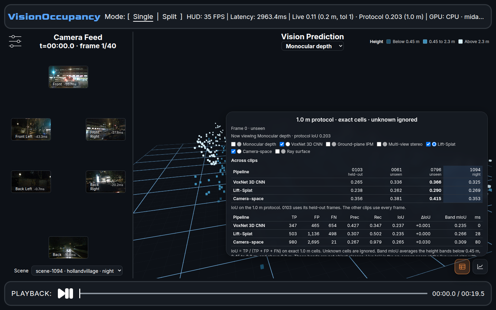
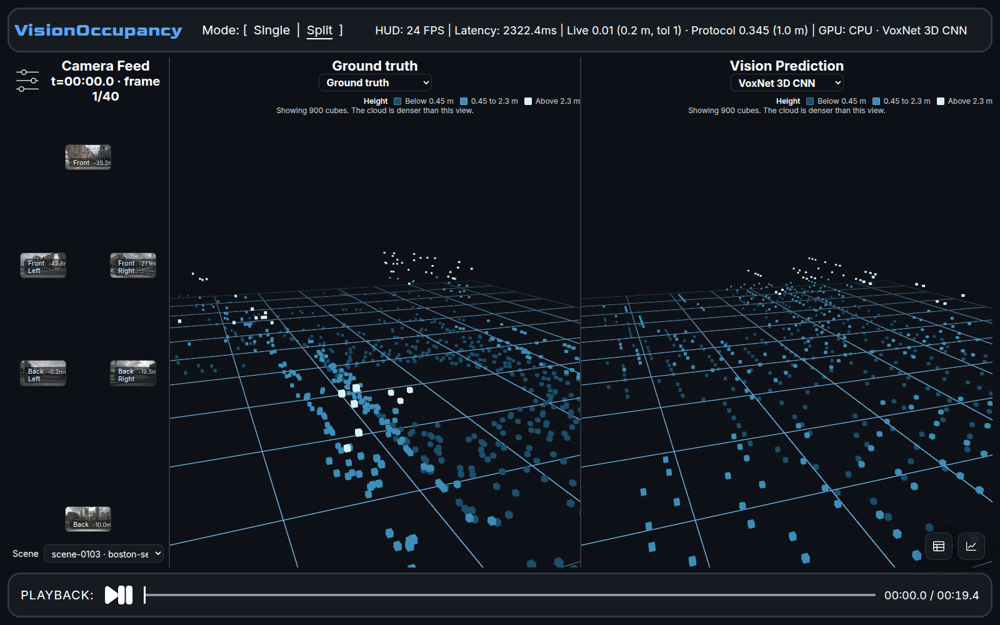

# VisionOccupancy

Compare camera-based 3D occupancy with lidar you can see. Six surround cameras go in. A 3D cloud and a score come out. The score uses one rule on four nuScenes clips, so a number on the training clip is not the same claim as a number on a clip the model never trained on.





**Stack:** React, TypeScript, Three.js, FastAPI, PyTorch, NumPy.

## Results

IoU on the 1.0 m protocol. Higher is better. scene-0103 is 8 held-out frames from the training clip. The other three columns use every frame, and those clips were not used for training.

| Model | 0103 held-out | 0061 unseen | 0796 unseen | 1094 night |
| --- | ---: | ---: | ---: | ---: |
| Ray surface | 0.375 | 0.283 | 0.284 | 0.279 |
| Camera-space | 0.356 | 0.381 | 0.415 | 0.353 |
| VoxNet 3D CNN | 0.265 | 0.336 | 0.366 | 0.325 |
| Monocular depth | 0.263 | 0.298 | 0.306 | 0.275 |
| Lift-Splat | 0.238 | 0.262 | 0.290 | 0.269 |
| Ground-plane IPM | 0.144 | 0.175 | 0.201 | 0.199 |
| Multi-view stereo | 0.006 | 0.003 | 0.006 | 0.003 |

Ray surface leads the training clip's held-out frames. Camera-space leads the three unseen clips, including the night drive. Multi-view stereo is a classical baseline and stays near zero on these clips. The same numbers are in the Across clips table in the app.

## How a score is computed

Two numbers are on screen, and they are not interchangeable.

- **Live** is the cloud you are looking at. The default grid is 0.2 m, with a one-cell tolerance. This is the HUD and the distance chart.
- **Protocol** is the comparison. Cells are 1.0 m. A cell counts only where the cameras can mark it occupied or free. Unknown cells are ignored. IoU = TP / (TP + FP + FN). Tolerance is zero: the predicted cell has to be the same cell.

scene-0103 (boston-seaport, 40 frames) is the only training clip. Its protocol column uses every fifth frame, the ones held out of training. scene-0061 (onenorth, 39 frames), scene-0796 (queenstown, 40 frames), and scene-1094 (hollandvillage at night, 40 frames) are scored on every frame.

Height-band mIoU is the mean of that IoU below 0.45 m, from 0.45 m to 2.3 m, and above 2.3 m. Those bands are height, not object classes.

## What you can do in the app

- Scrub a clip and watch the six cameras with the 3D cloud.
- Switch the cloud between lidar ground truth and any predictor.
- Compare two or more models on the current frame, with precision, recall, and the gap versus a reference model.
- Read the protocol IoU for all four clips without switching scenes.
- Color false positives and misses, fade the cubes, and hide cells past a horizontal range. The scores stay on the full grid.
- Open the distance chart for the live score at 0–10 m, 10–25 m, and 25 m+.

The view draws at most 900 cubes. When the cloud is denser, the pane says so.

## Models

| Model | What it is | Code |
| --- | --- | --- |
| Monocular depth | Frozen MiDaS depth, scaled to the ground plane, then unprojected | `backend/midas_engine.py` |
| VoxNet 3D CNN | A small 3D CNN over a voxel volume | `backend/voxnet_baseline.py` |
| Lift-Splat | A small lift-splat network | `backend/lss_baseline.py` |
| Camera-space | The same lift-splat architecture, trained only on cells the cameras can label | `backend/camera_space_baseline.py` |
| Ray surface | Per-pixel depth and a keep decision, unprojected into cells. No 3D convolution | `backend/ray_surface_baseline.py` |
| Ground-plane IPM | Inverse perspective mapping onto the ground plane | `backend/ipm_baseline.py` |
| Multi-view stereo | SIFT matches, triangulated across cameras | `backend/stereo_baseline.py` |

The learned models were fit on scene-0103 only. Checkpoints live under `backend/data/`.

## Layout

```
frontend/     React UI. Vite proxies /api and /ws to the API.
backend/      FastAPI. Occupancy is a binary websocket frame.
backend/data/nuscenes/   Prepared images, lidar, depth maps, and protocol summaries.
```

The API listens on port 8000. The UI listens on port 5173.

## Run

Python 3.10 or newer, and Node.js 18 or newer.

```bash
python3 -m pip install -r backend/requirements.txt
npm install --prefix frontend
./start.sh
```

Open http://127.0.0.1:5173. Ctrl-C stops the API and the UI. `start.sh` runs the API on http://127.0.0.1:8000.

## Tests

```bash
cd backend && python3 -m unittest discover -s . -p 'test_*.py'
```

The tests cover the protocol math, the lidar window, the scene split, and the rule that a prediction cached for one scene is not reused on another.

## Data

The images, lidar, and MiDaS depth maps under `backend/data/nuscenes` are a prepared subset of [nuScenes](https://www.nuscenes.org/) mini (Caesar et al., CVPR 2020). They are in the repo so the workbench opens without downloading the dataset again. nuScenes itself is distributed under its own license.

## Limits

This is four clips from nuScenes mini, not the full validation set. The learned models saw only scene-0103. A far cell is harder than a near cell, and the distance chart is there to show that on the live grid. The 3D view samples the cloud at 900 cubes, so a dense lidar return is not drawn as every point.
